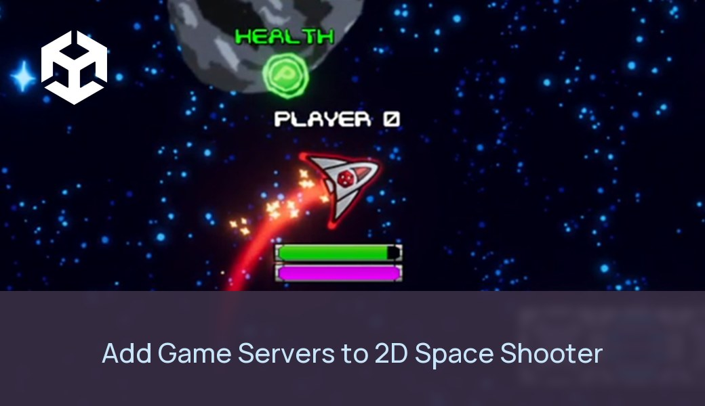

# 2D Space Shooter: Netcode for GameObjects on Edgegap



This sample shows a headless Linux server on Edgegap for a Unity project using [Netcode for GameObjects](https://github.com/Unity-Technologies/com.unity.netcode.gameobjects) (NGO) as its networking solution.

It uses the open-source 2D sample project `2DSpaceShooter` from [Unity bitesize samples](https://github.com/Unity-Technologies/com.unity.multiplayer.samples.bitesize/). The project targets `Unity 2021.3 LTS` (opened with 2021.3.45f2) with the Linux Dedicated Server Build Support module.

For a current NGO walkthrough with matchmaking, see the [Unity NGO guide](https://docs.edgegap.com/docs/sample-projects/unity-netcodes/unity-netcode-on-edgegap) (Boss Room sample).

## Build the server

1. Open the project in Unity 2021.3 LTS.
2. Open **File > Build Settings**, select **Linux**, set **Server Build** (Dedicated Server), keep `Assets/Scenes/network` in the scene list and build to a `server` folder, for example `Builds/server/Server.x86_64`.
3. The server starts itself (`NetworkManager.StartServer()` on a Server build), listens on `0.0.0.0:7777` (UDP) and quits when the last client leaves, so the Edgegap deployment ends with the match.

## Containerize and push

Create a `Dockerfile` next to the `server` folder:

```dockerfile
FROM ubuntu:22.04
RUN apt-get update && apt-get install -y --no-install-recommends ca-certificates libglib2.0-0 && rm -rf /var/lib/apt/lists/*
WORKDIR /app
COPY server/ /app/
RUN chmod +x /app/Server.x86_64
EXPOSE 7777/udp
ENTRYPOINT ["/app/Server.x86_64", "-batchmode", "-nographics", "-logFile", "-"]
```

Build it for `linux/amd64`, tag it with a timestamp such as `20261127-1814`, and push it to your Edgegap registry (credentials: Edgegap dashboard > Container Registry).

## Create the application and deploy

In the [Edgegap dashboard](https://app.edgegap.com), create an application and a version that uses the image, with one port named `netcode`, `7777`, `UDP`, and **Restart policy: never**. The sample client looks for the port named `netcode`.

Put the application name, the version name and an API token in the `EdgegapSampleHUD` component of the `network` scene (`appToken`, `appName`, `appVersionName`). The token is stored in the client build, so use it for local testing only. Build a Windows or Linux client and use **Create room & connect** to deploy a server and join it, or **Create room** and **Connect** from the list. In a real game the deployment call belongs on your backend.

More on Edgegap with Unity: [docs.edgegap.com](https://docs.edgegap.com).
